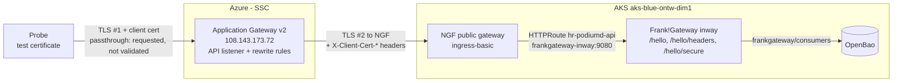
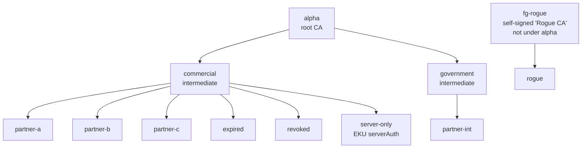

# Frank!Gateway — client-certificate test round on ontw-dim1

How the test round of the Azure Application Gateway (AAG) in passthrough
mode in front of the Frank!Gateway inway was set up on ontw-dim1, which test
PKI and probe it used, and the test matrix with the result of every test.
The setup and the expectations were fixed before the first probe. The
PodiumD team ran the round on 2026-11-04 and 2026-11-05; the design note that
follows from it is
[`frankgateway-aag-client-certificates.md`](frankgateway-aag-client-certificates.md).

| | |
|---|---|
| Status | **Closed 2026-11-05.** The path works as designed and the header contract is measured. One defect found and fixed: on chart 4.10.0 the inway never refreshed the consumer list (B15, IN-3417, fixed in 4.10.1). Tests that were not run are listed under [Outcome](#outcome) |
| Date | 2026-11-04 and 2026-11-05 |
| Tracked in | IN-3372 (execution), IN-3412 (results and documentation), IN-3288 (matrix origin), IN-3287 (architecture decision), DS-6618 (SSC side) |
| Environment | ontw-dim1, PodiumD 4.10.0 (from 2026-11-04 15:40 UTC with the IN-3417 fix on top), host `ontw-podiumd-api.dev.dimpact.nl` |
| Applies to | inway class only (`frankgateway.instances.inway`) |

Related: [`frankgateway-routes.md`](frankgateway-routes.md#consumer-identities-from-openbao-inbound)
(what the inway does with the headers),
[`frankgateway-traffic-classes.md`](frankgateway-traffic-classes.md)
(network policies), and the TSA setup guide
[`frankgateway-tsa-setup-and-flow-NL.md`](frankgateway-tsa-setup-and-flow-NL.md)
(steps 3 and 8 are filled in from the outcome of this round).

## Outcome

- **The design holds.** The AAG forwards any client certificate as four
  headers, on the API listener only; the inway admits a caller only when the
  fingerprint is registered in OpenBao and the consumer is in the route's
  `allow` list; a caller cannot forge the headers (B1, B2, B4 to B10, B13).
- **The header contract is measured**, see [Header contract](#header-contract).
  It is recorded as measured; no separate confirmation by SSC or WeAreFrank
  was asked.
- **One defect, fixed.** On chart 4.10.0 a removed consumer kept its access
  until the inway pods restarted (B15). Fixed in PodiumD 4.10.1 (IN-3417) and
  re-tested with the fix: a removal is live on every worker within 300 s.
- **The AAG checks nothing about the certificate** in passthrough mode: not
  the CA, not the validity period, not the key usage (B2, B3, B10). The
  inway's fingerprint list is the only gate. For the validity period that is
  not enough, so the inway gets a check of its own (decided on IN-3411,
  built on IN-3445 for PodiumD 4.10.2).
- **Not run**, accepted when the round was closed on 2026-11-05 (IN-3410):
  the registration half of B3 (moves to IN-3445), the register and remove
  cycle of B11 with the revoked leaf (the mechanism is the one B15 proves),
  the registration half of B12, B16 (OpenBao unreachable), the smoke baseline
  A8, and the three checks that need SSC: the WAF log (A3, B19) and the strip
  rule on the other listeners (B14).

## What the round proves

The architecture decision of 2026-10-29 (IN-3287) is: the AAG terminates TLS,
**requests** the client certificate in passthrough mode without validating it,
and forwards it as request headers on the API listener only. The inway
authorises on the SHA-1 fingerprint against the consumer list in OpenBao. No
CA is managed on the AAG, nothing changes in the chart.

The round has to show, on a real AAG and a real inway:

1. that the four headers arrive, with what names, encoding and size
   (the **header contract**, B17);
2. that the inway's answers match the design for every kind of certificate
   (registered, unknown, rogue CA, expired, revoked, wrong EKU, chain, none);
3. that a caller cannot forge the headers, on the API listener or on any other
   listener (B5, B6, B14);
4. where the AAG itself already refuses a certificate in passthrough mode, if
   anywhere (B10, B13);
5. the decision input for B3: whether the inway needs an expiry check of its
   own now that the AAG does not validate.

## The path under test



| Hop | What happens | Owner | Where it is configured |
|---|---|---|---|
| probe → AAG | TLS 1.3, SNI and Host `ontw-podiumd-api.dev.dimpact.nl`, TCP to the AAG IP directly so workstation DNS does not matter. The AAG sends a `CertificateRequest`; the probe answers with a leaf or a leaf plus intermediate, or nothing. | SSC | AAG API listener, SSL profile `verifyClientAuthMode = Passthrough` |
| AAG rewrite | Four request headers set from server variables: `X-Client-Cert` (PEM, URL-encoded), `X-Client-Cert-Fingerprint` (SHA-1 hex), `X-Client-Cert-Subject`, `X-Client-Cert-Issuer`. The same headers are **removed** on every other listener. | SSC | AAG rewrite rule set on the API routing rule |
| AAG → NGF | HTTPS 443, SNI = public host, as for every other hostname. | SSC | AAG backend HTTP settings |
| NGF → inway | HTTPRoute `hr-podiumd-api` to `frankgateway-inway:9080`, plain HTTP inside the cluster. No `BackendTLSPolicy` on dim1 today (B18 records whether that changes). | PodiumD | podiumd-infra / Haven pipeline, NGF objects |
| inway | Route by path; `/hello/secure` runs `openbao-consumer-auth` before the echo. | PodiumD | `applications/gemeenten/dim1/ontw/podiumd.yml` on `release/podiumd-4.10.x` in ExternalsPodiumD |
| inway → OpenBao | `GET <mount>/frankgateway/consumers`, cached 300 s, last-good list served up to `stale_ttl` (3600 s) when OpenBao is unreachable. | PodiumD | chart, `openbao-consumer-auth.lua` |

### The three inway routes

All three live on the dim1 inway with host `ontw-podiumd-api.dev.dimpact.nl`
and are deployed with the Applications pipeline. `hello-frank` has been live
since 2026-10-29; `hello-headers` and `hello-secure` are added for this round.

```yaml
frankgateway:
  instances:
    inway:
      routes:
        hello-frank:
          uri: /hello
          name: hello-frank
          host: ontw-podiumd-api.dev.dimpact.nl
          labels:
            managed-by: iac
          plugins:
            mocking:
              content_type: text/plain
              response_status: 200
              response_example: "Hello Frank!"
        hello-headers:
          uri: /hello/headers
          name: hello-headers
          host: ontw-podiumd-api.dev.dimpact.nl
          labels:
            managed-by: iac
          plugins:
            serverless-pre-function:
              phase: access
              functions:
                - 'return function(conf, ctx) local core = require("apisix.core") return core.response.exit(200, { uri = ngx.var.request_uri, remote_addr = ngx.var.remote_addr, headers = ngx.req.get_headers(100, true) }) end'
        hello-secure:
          uri: /hello/secure
          name: hello-secure
          host: ontw-podiumd-api.dev.dimpact.nl
          labels:
            managed-by: iac
          plugins:
            serverless-pre-function:
              phase: access
              functions:
                - 'local consumer_auth = require("openbao-consumer-auth") return consumer_auth({ path = "frankgateway/consumers", allow = { "partner-a" } })'
                - 'return function(conf, ctx) local core = require("apisix.core") return core.response.exit(200, { uri = ngx.var.request_uri, remote_addr = ngx.var.remote_addr, headers = ngx.req.get_headers(100, true) }) end'
```

| Route | Auth | Answers | Used by |
|---|---|---|---|
| `/hello` | none | `200 Hello Frank!` (mocking plugin) | smoke test, B4, B7, test 192 in podiumd-testautomation |
| `/hello/headers` | none | `200` JSON `{uri, remote_addr, headers}`: every request header as the inway received it, raw (`get_headers(100, true)` keeps the original case and does not parse) | the header contract, every B-test's left column |
| `/hello/secure` | `openbao-consumer-auth`, path `frankgateway/consumers`, `allow = { "partner-a" }`, no `verificationHeader` | `401` unknown or missing fingerprint, `403` known consumer not in `allow`, `503` OpenBao unreachable and no last-good list, `200` with the same echo and `X-Consumer-Username` set | every B-test's right column |

Two things the chart enforces that shape the round:

- **Network policies are coupled to consumer-auth.** The chart refuses to
  render an `openbao-consumer-auth` function while
  `frankgateway.networkPolicies.enabled` is `false`, so step 7 of IN-3372
  (policies on, `ingressNamespace: ingress-basic`, the NGF data plane) is
  deployed together with step 2. The render diff is exactly two
  NetworkPolicies (inway, outway) and two seed ConfigMap entries.
- **Consumer-auth is refused outside the inway class.** Nothing to do, just
  the reason the echo routes are on the inway and nowhere else.

### The consumer list in OpenBao

One KV entry, `<mount>/frankgateway/consumers`, one field per consumer whose
value is the SHA-1 fingerprint of the certificate (several, comma-separated,
during a rotation). The lookup normalises case, colons and spaces, so the
`openssl` form with colons and the AAG's form are both fine. Changes are live
within 300 s; **note the time of every write** and wait out the cache before
reading a result.

```sh
# step 3 of IN-3372: register the two consumers the matrix needs from the start
bao kv patch <mount>/frankgateway/consumers partner-a=<sha1 of partner-a.crt> partner-c=<sha1 of partner-c.crt>

# B3 and B11 register and remove more during the round
bao kv patch <mount>/frankgateway/consumers expired=<sha1 of expired.crt>
bao kv patch <mount>/frankgateway/consumers revoked=<sha1 of revoked.crt>
bao kv patch <mount>/frankgateway/consumers partner-int=<sha1 of partner-int.crt>
# removal: rewrite the entry without that field
bao kv get -format=json <mount>/frankgateway/consumers   # then bao kv put with the fields that stay
```

The fingerprints themselves are not in this document: the PKI is re-issued
whenever its script runs, which gives new fingerprints, and the live values
belong in OpenBao, not in git.

**Measured 2026-11-04 (B15): the 300 s is not true on chart 4.10.0.** An
entry, once read, is served until the pod restarts, because the lrucache is
created without `invalid_stale`. Until the chart fix is deployed, a removal
needs `kubectl rollout restart deployment/frankgateway-inway` to take effect.
With the fix (IN-3417, PodiumD 4.10.1) a write is live on every worker after
at most 300 s; inside that window answers are mixed, because each nginx
worker keeps its own copy and re-reads when its own 300 s have passed.

On dim1 the step-3 write was done on 2026-11-04 at 13:05:21 UTC (`secret/`
mount, version 1, `partner-a` and `partner-c`). Two things to know before
repeating it: the writer needs an OpenBao token from `bao login -method=oidc`
as a member of the Keycloak group `vault-uploaders` in the `podiumd` realm,
and the Microsoft button on that realm's login page only works for INFO
accounts (the identity provider `oidc-info` pins the token issuer to INFO's
tenant), so everyone else uses a local realm user. On the inway the cache
made no difference here: the first `/hello/secure` call after the write
already answered 200, because the earlier 404 on the path had not been
cached as a list.

## The test PKI

The certificates are issued by **Certosaur**, the small CA web application in
`Sunningdale-IT/apigw-poc` (`certosaur/`, Docker Compose, web UI on
`http://localhost:5003`). A script, `certosaur-pki.sh`, drives the web UI the
way a person would (login form, CSRF cookie, create forms, download links)
and uses the Django shell inside the container only for what the UI cannot
do: wipe the previous `fg-*` objects and back-date the expired certificate.
It writes to `~/podiumd-fg-test/pki`, refuses any path under `~/src`, and
wipes and rebuilds that folder on every run. Private keys and the issued
leaves never enter a repository.

### Hierarchy



`alpha`, `commercial` and `government` are Certosaur's standing CAs; the
script creates the rogue CA and all leaves itself. RSA 2048 throughout,
leaves valid 365 days from issue, organisation `Dimpact PodiumD test`,
country `NL`.

### Leaves and what each one is for

| Leaf | Issuer | Property under test | Matrix | Registered in OpenBao | Expected at `/hello/secure` |
|---|---|---|---|---|---|
| `partner-a` | commercial | the happy path | B1, B6, B15 | yes, and in `allow` | 200 |
| `partner-b` | commercial | known CA, never registered | B8 | no | 401 |
| `partner-c` | commercial | registered, but not in the route's `allow` | B9 | yes | 403 |
| `rogue` | fg-rogue | issuer unknown to anyone | B2 | no | 401 |
| `expired` | commercial | `notAfter` 2025-02-01, built in the Django shell because the create form refuses `validity_days < 1`; stored as a normal record with status `expired` | B3 | no, then yes | 401, then 200 (decision point) |
| `revoked` | commercial | revoked in Certosaur (reason key compromise). Certosaur publishes **no CRL**, so revocation is a database status only and nothing on the wire differs from `partner-b` | B11 | yes, then removed | 200, then 401 within 300 s |
| `server-only` | commercial | a server certificate (EKU `serverAuth` only) used as a client certificate; created through the server-certificate form | B10 | no | 401, unless the AAG refuses the handshake |
| `partner-int` | government | the other intermediate, so the chain in `X-Client-Cert` is leaf + intermediate the AAG has never seen | B12 | no, then yes | 401, then 200 |
| `partner-a` + `partner-b.key` | — | wrong private key (B13): no file, the probe pairs the two and the TLS library refuses the mismatch locally | B13 | — | handshake never completes |

Files per leaf: `<name>.crt`, `<name>.key` and `<name>.chain.pem` (leaf
followed by its intermediate; `rogue` has no chain file). The probe sends the
chain file when it exists, so B1 and B12 both present two certificates and
the round records how many of them come back in `X-Client-Cert`.
`fingerprints.txt` in the same folder lists, per leaf, the `openssl` SHA-1
fingerprint, its normalised form (lower case, no colons), subject, `notAfter`
and issuer: the values to paste into OpenBao and to compare against the
`X-Client-Cert-Fingerprint` header.

Re-running the script re-issues everything, so **every fingerprint
registered in OpenBao must be registered again** after a re-run.

## The probe

`fg-probe.py` (`~/podiumd-fg-test/tools/`, Python 3 standard library only)
makes one request through the AAG and prints what the inway received.

```text
fg-probe.py <cert-name|none|wrong-key> [path] [-H 'Name: value' ...] [--http]

  cert-name   a leaf from the test PKI: <name>.chain.pem is sent when it
              exists, else <name>.crt; "none" sends no client certificate;
              "wrong-key" sends partner-a.crt with partner-b.key
  path        default /hello/headers
  -H          extra request header, repeatable (B5, B6: forged headers)
  --http      plain HTTP on port 80 instead of TLS (B7)

Env: PKI (~/podiumd-fg-test/pki), HOST (ontw-podiumd-api.dev.dimpact.nl),
     AAG_IP (108.143.173.72)
```

What one run prints, in order:

1. a stamp line: UTC time, certificate name, URL, the AAG IP and any extra
   headers, so the line can be pasted into the matrix as the `Command`
   evidence;
2. the TLS version, cipher and the CN of the server certificate the AAG
   presented;
3. the HTTP status line, and `Location` on a redirect;
4. for a JSON echo body: `uri`, `remote_addr`, then the headers that matter
   (`X-Client-Cert`, `-Fingerprint`, `-Subject`, `-Issuer`, `-Verification`,
   `X-Consumer-Username`, `X-Forwarded-For`, `X-Forwarded-Host`, `Host`),
   each shown as present with its first 120 characters and total length, or
   as `(absent)`; then the names of all other headers;
5. for a non-empty `X-Client-Cert`: the URL-decoded PEM's certificate count
   and byte size, `openssl x509` subject, issuer, dates and SHA-1 fingerprint
   of the first certificate, and `openssl verify -purpose sslclient` of that
   certificate against `alpha-ca.crt` with both intermediates as untrusted.

Local refusals (certificate and key do not match) and handshake failures
(the AAG closed the connection during TLS) are printed as such and exit 1,
which is itself a result for B13 and possibly B10.

Why not `curl`: macOS ships a SecureTransport `curl` that cannot load a PEM
client certificate, and `openssl s_client` cannot easily send a full HTTP
request with a chunked JSON answer. The Python `ssl` module is OpenSSL-backed,
so PEM certificates and chains work, and connecting to the AAG IP with
`server_hostname` set to the public host keeps the test independent of the
workstation's DNS (see DS-7021 for why that matters on dim1).

## Preconditions

| # | Owner | Precondition | How to check | Status |
|---|---|---|---|---|
| A1 | SSC | API listener on the AAG with a passthrough SSL profile and the four header rewrites; the same headers stripped on all other listeners | `fg-probe.py none` on the API host shows a `CertificateRequest` in the handshake (the probe gets through with any certificate); B14 for the strip rule | done 2026-11-04: `openssl s_client -msg` shows one `CertificateRequest` on `ontw-podiumd-api` and none on `ontw-formulier`; the strip rule on the other listeners is not observable from outside (see B14) |
| A2 | SSC | listener certificate with the `ontw-podiumd-api` SAN | server CN and SAN in the probe's TLS line; `openssl s_client -servername` | done: the AAG serves the certificate of 29 Oct (CN `ontw-formulier.dev.dimpact.nl`, SAN includes `ontw-podiumd-api`, valid to 2027-01-27) |
| A3 | SSC | WAF on the API listener does not block a ~2 KB URL-encoded PEM header | B1 passes with all four headers; SSC watches the WAF log during B1 | B1 passes with an `X-Client-Cert` of 1881 characters, so the WAF does not block it; the WAF log itself was not read (not run) |
| A4 | PodiumD | the three inway routes deployed on dim1 with network policies on | Applications run on `release/podiumd-4.10.x` green; `/hello/headers` answers 200 from inside the cluster | done 2026-11-04: Applications run <https://dev.azure.com/ssctwente/ExternalsPodiumD/_build/results?buildId=38655> (chart 4.10.0, helm revision 74), NetworkPolicies `frankgateway-inway` and `frankgateway-outway` live; `/hello/headers` 200 through the AAG |
| A5 | PodiumD | test PKI issued by Certosaur | `~/podiumd-fg-test/pki` complete, `fingerprints.txt` present | done 2026-11-04 11:57 UTC: Certosaur set, `fingerprints.txt` present |
| A6 | PodiumD | `partner-a` and `partner-c` registered in OpenBao, time of the write noted | `bao kv get <mount>/frankgateway/consumers` | done 2026-11-04 13:05:21 UTC: version 1 with `partner-a` and `partner-c` |
| A7 | PodiumD | probe working from a host whose path to the AAG is clean | `fg-probe.py none /hello` gives `200 Hello Frank!` | done 2026-11-04: `200 Hello Frank!` |
| A8 | PodiumD | baseline: dim1 smoke tests green, `/hello` answers 200 through the internal load balancer before the AAG change | podiumd-testautomation smoke run, test 192 | not run |

## Test matrix

Each test is one or more probe runs. `Expected` is fixed by the design;
`Result` records the status line and the headers as the probe printed them;
`Verdict` is `pass`, `fail` or `not run`; the raw probe output is attached to
IN-3410. The S-numbers are SSC's tests on the POC
(DS-6618), reproduced here on dim1.

### Certificate handling

| # | S | Case | Probe | Expected at `/hello/headers` | Expected at `/hello/secure` | Result `/hello/headers` | Result `/hello/secure` | Date | Verdict |
|---|---|---|---|---|---|---|---|---|---|
| B1 | S1, S6 | partner-a: known CA, registered, in `allow` | `fg-probe.py partner-a` and `fg-probe.py partner-a /hello/secure` | 200; four headers filled; decoded PEM verifies against alpha via commercial; `X-Client-Cert-Fingerprint` equals the SHA-1 in `fingerprints.txt` | 200 `X-Consumer-Username: partner-a` | 200; `X-Client-Cert` 1881 chars, decodes to 1 certificate of 1749 bytes, `openssl verify -purpose sslclient` OK via commercial; `X-Client-Cert-Fingerprint` `6ad999…40a1` equals `fingerprints.txt`; Subject and Issuer filled (format in the header contract) | 200, `X-Consumer-Username: partner-a`; access log `consumer: partner-a` | 2026-11-04 13:05 | pass |
| B2 | S2, S5 | rogue: unknown CA | `fg-probe.py rogue` | 200; headers filled; issuer `CN=Rogue CA`; forwarded by design (no CA check at the AAG) | 401 | 200; headers filled; issuer `C=NL,O=Dimpact PodiumD test,CN=Rogue CA`; decoded PEM fails `openssl verify` against alpha (error 20, no local issuer) as expected: the AAG forwarded it untouched | 401 `unknown_client_certificate` | 2026-11-04 13:05 | pass |
| B3 | S3 | expired: known CA, `notAfter` in the past | `fg-probe.py expired`; then register, wait 300 s, `fg-probe.py expired /hello/secure` | 200; headers filled; `notAfter` 2025-02-01 in the decoded PEM | 401 while unregistered, 200 once registered. **Decision point:** expiry check in the inway, yes or no (C2, IN-3411) | not run | 401 `unknown_client_certificate` while unregistered; the registration half was not run, because the decision went the other way: IN-3411 adds a `notAfter` check to `openbao-consumer-auth` (C2), after which the expected answer is 401 `client_certificate_expired` before and after registration | 2026-11-04 13:05 | unregistered half pass; registration half not run, moves to IN-3445 |
| B4 | S4 | no certificate | `fg-probe.py none /hello` and `fg-probe.py none` | `/hello` 200; `/hello/headers` 200 with all four headers empty or absent (record which) | 401 | `/hello` 200 `Hello Frank!`; `/hello/headers` 200 with all four headers **absent** (not empty) | 401 `client_certificate_required` | 2026-11-04 13:05 | pass |
| B5 | S7 | no certificate, forged fingerprint | `fg-probe.py none -H 'X-Client-Cert-Fingerprint: nep'` | header empty or absent, never `nep` | 401 | 200; all four headers absent, the forged value never reaches the inway | 401 `client_certificate_required` (also with a forged copy of partner-a's real fingerprint) | 2026-11-04 13:05 | pass |
| B6 | S8 | partner-a with a forged fingerprint | `fg-probe.py partner-a -H 'X-Client-Cert-Fingerprint: nep' /hello/secure` | the real fingerprint, not `nep` | 200 | the real fingerprint `6ad999…40a1`, not `nep` | 200 `X-Consumer-Username: partner-a`; the mirror case, partner-b with partner-a's fingerprint forged, gives 401 `unknown_client_certificate` | 2026-11-04 13:05 | pass |
| B7 | S9 | plain HTTP on port 80 | `fg-probe.py none /hello --http` | 301 to `https://` | n/a | 301, `Location: https://ontw-podiumd-api.dev.dimpact.nl/hello`, body signed `Microsoft-Azure-Application-Gateway/v2` | n/a | 2026-11-04 13:08 | pass |
| B8 | S10 | partner-b: known CA, not registered | `fg-probe.py partner-b` | 200; headers filled | 401 | not re-probed on `/hello/headers`; the inway error log for the `/hello/secure` call reads `no consumer in frankgateway/consumers matches X-Client-Cert-Fingerprint`, so the headers arrived | 401 `unknown_client_certificate` | 2026-11-04 13:05 | pass |
| B9 | S11 | partner-c: registered, not in `allow` | `fg-probe.py partner-c /hello/secure` | fingerprint present in the consumer list | 403 | `partner-c` present in the consumer list (A6) | 403 `consumer_not_allowed`; inway log `consumer partner-c is not allowed on this route` | 2026-11-04 13:05 | pass |
| B10 | S12 | server-only: EKU `serverAuth` | `fg-probe.py server-only` | either forwarded with headers filled, or refused at the AAG handshake; **record which** | 401 if forwarded | **forwarded**: the AAG completes the handshake with a `serverAuth`-only certificate; no EKU check in passthrough mode | 401 `unknown_client_certificate` | 2026-11-04 13:05 | pass; decision input for IN-3287 recorded below |
| B11 | S13 | revoked: known CA, revoked at the issuer | register, wait 300 s, probe `/hello/secure`; remove, probe again within and after 300 s | 200; headers filled (the AAG has no CRL) | 200 once registered, 401 within 300 s of removal. This is the revocation path of the design | 200; headers filled (same as partner-b on the wire) | 401 `unknown_client_certificate` while unregistered; the register, wait, remove cycle was not run | 2026-11-04 13:05 | unregistered half pass; register and remove cycle not run. Removal of a fingerprint is the mechanism B15 proves with partner-a |
| B12 | S14 | partner-int: leaf under the other intermediate, chain sent | `fg-probe.py partner-int`; register the leaf, probe `/hello/secure` | 200; **count the certificates** in `X-Client-Cert` (1 or 2); fingerprint is the leaf's | 200 once the leaf fingerprint is registered | 200; the probe sent leaf + Government intermediate, `X-Client-Cert` holds **1 certificate, the leaf only** (1749 bytes); fingerprint `64e653…1ce5` is the leaf's; verify OK via government | 401 `unknown_client_certificate` (leaf not registered); the registration half was not run | 2026-11-04 13:08 | header half pass; registration half not run |
| B13 | new | wrong private key | `fg-probe.py wrong-key` | local refusal or handshake failure at the AAG; optional, TLS guarantees it | n/a | local refusal before any handshake: `[X509: KEY_VALUES_MISMATCH] key values mismatch` | n/a | 2026-11-04 13:05 | pass |

### Listeners, timing, resilience

| # | S | Case | Probe | Expected | Result | Date | Verdict |
|---|---|---|---|---|---|---|---|
| B14 | S15 | other hostnames | `HOST=ontw-formulier.dev.dimpact.nl fg-probe.py partner-a /` and with `-H 'X-Client-Cert-Fingerprint: nep'` | no `CertificateRequest` on the other listeners; forged `X-Client-Cert-*` headers do not reach the applications (SSC confirms the strip rule, PodiumD checks an application access log) | `CertificateRequest`: 1 on `ontw-podiumd-api`, 0 on `ontw-formulier` (`openssl s_client -msg`). Forged `X-Client-Cert` and `-Fingerprint` on the formulier listener: the application answers 403 on `/` and 404 on `/hello/headers`; there is no echo on that host, so the strip rule is not observable from outside | 2026-11-04 13:09 | listener half pass; strip rule not confirmed (not run) |
| B15 | new | cache timing | add `partner-a`, remove it, add it again; probe `/hello/secure` every 30 s | 200, 401, 200; record the real delay against the 300 s cache | **FAIL.** partner-a removed from OpenBao at 14:47:07 UTC (KV version 2, verified); both inway pods kept answering 200 for 335 s, until it was restored at 14:52:42 (version 3). No OpenBao error in the inway log: the list was never re-read. Cause: `openbao-client.lua` creates its cache with `core.lrucache.new({ ttl = 300, count = 32 })` without `invalid_stale = true`; APISIX 3.19 `fetch_valid_cache` re-arms an expired entry with the old value for another TTL instead of refreshing it, so a consumer list, once read, lives until the pod restarts. The first write of the day did take effect at once only because a failed read (404) is never cached. Fix: `invalid_stale = true`, and not `refresh_stale`, which would serve the expired entry while a timer retries and so bypass `stale_ttl`. **Re-test with the fix, 2026-11-05** (chart 4.10.0 with `invalid_stale`, helm-charts branch `feature/ontw-dim1-podiumd-4.10.0-IN-3417-openbao-cache-refresh`, helm revision 75): partner-a removed at 06:53:44 UTC, first 401 after 152 s; restored at 06:56:17, 19 s later 13 of 24 probes 200 and 11 of 24 still 401, 336 s later 30 of 30 probes 200. The cache is per nginx worker, so for up to 300 s after a write the answers are mixed; after 300 s every worker has the new list | 2026-11-04 14:47, 2026-11-05 06:53 | fail on 4.10.0 (IN-3417); pass with the fix |
| B16 | new | OpenBao unreachable (optional, disruptive: scale OpenBao to 0 on dim1, announce first) | probe `/hello/secure` with partner-a repeatedly | the last-good list keeps serving 200 up to `stale_ttl` 3600 s, then 503; recovers after OpenBao is back | not run | | not run |
| B19 | new | logging | inway access log during B1, B8, B9 | `consumer` field on 200; reason on 401 and 403; no WAF blocks on the AAG side | access log (JSON) has `consumer: partner-a` on the 200 and `consumer: ""` on 401 and 403; the error log names the reason per `request_id`: `consumer partner-c is not allowed on this route` (403), `no consumer in frankgateway/consumers matches X-Client-Cert-Fingerprint` (401 unknown), `no X-Client-Cert-Fingerprint on the request` (401 required). The WAF log was not read | 2026-11-04 13:05 | inway half pass; WAF half not run |

### Header contract

Filled in from B1, B4 and B12, as measured on ontw-dim1. This is the item
IN-2818 is closed on and the table that the design note and the TSA guide
refer to.

| Property | Measured value | Source |
|---|---|---|
| Header names and case as received by the inway | `X-Client-Cert`, `X-Client-Cert-Fingerprint`, `X-Client-Cert-Subject`, `X-Client-Cert-Issuer`, in exactly this case; no other `X-Client-Cert-*` header | B1 |
| `X-Client-Cert` encoding (URL-encoded PEM: `%0A`, `%20`, `%2B`, `%2F`, `%3D`) | URL-encoded PEM: `-----BEGIN%20CERTIFICATE-----%0A…`; only `%20` (the two spaces in the BEGIN and END lines), `%0A`, `%2B`, `%2F` and `%3D` occur; 1881 characters for a 1749-byte PEM | B1 |
| Whitespace and line breaks inside the decoded PEM | LF only, no CR, no spaces inside the base64; 64-character lines; one trailing LF after `-----END CERTIFICATE-----` | B1 |
| Number of certificates in `X-Client-Cert` when the client sends a chain | **1, the leaf only**, also when the client sent leaf + intermediate (B12): the inway never sees the chain, so the design's fingerprint-of-the-leaf rule holds and no chain validation is possible on the inway side | B1, B12 |
| `X-Client-Cert-Fingerprint` algorithm, case and separator (SHA-1, 40 hex, with or without colons) | SHA-1, 40 hex characters, **lower case, no colons** (`6ad999…40a1`); equals `openssl x509 -fingerprint -sha1` after normalisation | B1 |
| `X-Client-Cert-Subject` and `-Issuer` DN format and attribute order | comma-separated, no spaces after the comma, RDNs in **reverse** order to the `openssl` one-line form: `C=NL,O=Dimpact PodiumD test,CN=partner-a`; issuer `L=San Francisco,ST=California,C=US,OU=Commercial Division,O=Alpha Corporation,CN=Commercial Intermediate CA` | B1, B2 |
| Value of the four headers when no certificate was presented (empty string or header absent) | all four headers **absent**; a client-supplied `X-Client-Cert-*` header is dropped as well (B5) | B4 |
| Maximum size the AAG forwards and the WAF accepts | 1881-character header (RSA 2048 leaf) passes AAG and WAF; the upper limit was not probed | A3, B1, B12 |
| `X-Client-Cert-Verification` | not sent in passthrough mode; `verificationHeader` stays unset on the route | design |

### Inner hop

| # | Case | Check | Expected | Result | Date | Verdict |
|---|---|---|---|---|---|---|
| B18 | NGF to inway | `kubectl --context aks-blue-ontw-dim1 -n ingress-basic get httproute hr-podiumd-api -o yaml` and `get backendtlspolicy -A` | today the backend is `frankgateway-inway:9080` over plain HTTP, no `BackendTLSPolicy`. Record whether SSC's open point (HTTPS to the inway) is to be taken up and in which ticket; headers unchanged either way | `ingress-basic/hr-podiumd-api` → `frankgateway-inway:9080`, no `BackendTLSPolicy` in any namespace on 2026-11-04. Headers unchanged. The open point (HTTPS to the inway) stays with SSC on DS-6618 | 2026-11-04 | recorded; decision open on DS-6618 |

## Decisions the round feeds

| Decision | Input | Outcome |
|---|---|---|
| B3: does the inway check `notAfter` of the forwarded certificate? Without it an expired certificate stays valid until its fingerprint is removed from OpenBao | the AAG forwards an expired certificate like any other (B3, 2026-11-04) | yes: the inway gets a validity check of its own (IN-3411, built on IN-3445 for PodiumD 4.10.2); until it is released an expired but registered certificate is admitted |
| B10: is an EKU check wanted anywhere? | the AAG **forwards** a `serverAuth`-only certificate (B10, 2026-11-04); only the fingerprint list keeps it out | no check; registering such a certificate is the registrar's decision |
| B18: re-encrypt NGF to inway on dim1? | B18 state, SSC's open point on DS-6618 | open, on DS-6618 |

## Wrap-up

What was done with the results (step 6 of IN-3372, tracked on IN-3412):

- **C1** The result per test is in the matrix above and as a comment on
  IN-3372 and IN-3287; the raw probe output is attached to IN-3410. Decoded
  PEMs and private keys are not in git and not in any attachment.
- **C2** The B3 decision is recorded on IN-3287 and IN-3411 and built on
  IN-3445.
- **C3** The [header contract](#header-contract) closes IN-2818.
- **C4** The design note
  [`frankgateway-aag-client-certificates.md`](frankgateway-aag-client-certificates.md)
  is rewritten for passthrough mode (the version written for IN-2658 described
  verify mode and was never merged), the front-door section of
  [`frankgateway-routes.md`](frankgateway-routes.md#what-the-front-door-must-send)
  carries the measured header format, and the TSA guide has its AAG steps
  (3, 8 and 9) filled in.
- **C5** The dim1 smoke tests after the AAG change, including test 192
  (frankgateway health) in podiumd-testautomation, were not run.

The same setup with a shortened round goes to the test and acceptance
environments of Enschede under IN-3428, once SSC has resolved the AAG
listener limit (production at 97 of 100).
